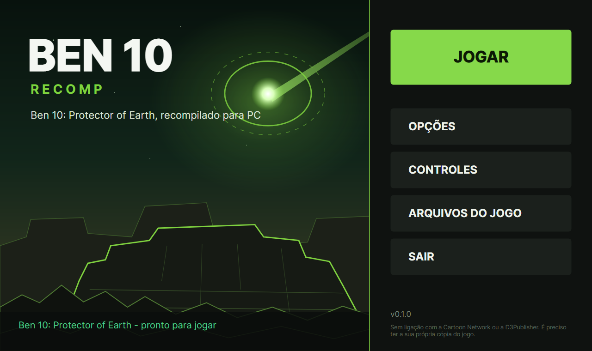
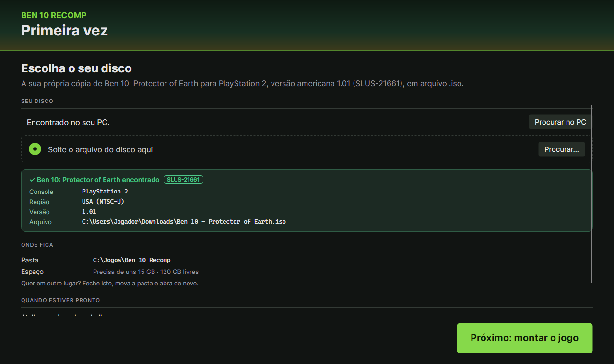

# Ben 10 Recomp

**Ben 10: Protector of Earth** (PlayStation 2) rodando como um programa nativo de PC: imagem em alta resolução,
widescreen, vídeos, som, saves, teclado e controle. Feito por recompilação estática com o
[PS2Recomp](https://github.com/ran-j/PS2Recomp), sobre o runtime do
[def-jam-vendetta-recomp](https://github.com/jcsix694/def-jam-vendetta-recomp).

<p align="center"></p>

### [⬇ Baixar para Windows (Ben10-Recomp-Windows.zip)](https://github.com/guilhermeperecim-jpg/ben10-protector-of-earth-pc/releases/latest/download/Ben10-Recomp-Windows.zip)

> [!IMPORTANT]
> **Nenhum arquivo do jogo vem neste projeto.** Você precisa da **sua própria cópia** do disco (uma ISO da versão
> americana 1.01). O launcher monta o jogo no seu PC a partir dela, e nada do jogo sai do seu computador.

## Como jogar

1. **Baixe** o zip acima e descompacte num caminho curto, como a Área de Trabalho ou `C:\Jogos`. Precisa de uns 15 GB.
2. **Abra o `Ben 10 Recomp Launcher.exe`.** Na primeira vez ele procura a sua ISO no PC sozinho (Downloads, Área de
   Trabalho, Documentos e os discos) e confere se é a versão certa. Se não achar, é só clicar em **Procurar…** ou
   arrastar o arquivo para a janela.
3. **Próximo: montar o jogo.** O launcher instala as ferramentas de C++ gratuitas da Microsoft, se faltarem (o Windows
   pede permissão uma vez), e monta o jogo no seu PC. **Isso leva de 30 a 60 minutos, uma vez só**, e precisa de
   internet. Você pode usar o PC enquanto isso.
4. **JOGAR.** Depois disso o jogo abre na hora, pelo launcher ou pelo atalho **Ben 10 Recomp**.

<p align="center">


</p>

> [!TIP]
> Se o Windows mostrar **"O Windows protegeu o computador"**, clique em **Mais informações** e depois em
> **Executar assim mesmo**. O programa ainda não é assinado com um certificado pago.

### Do que precisa

| | |
|---|---|
| Sistema | Windows 10 ou 11, 64 bits |
| Placa de vídeo | Com Vulkan e driver atualizado (testado numa GeForce GTX 1650) |
| Espaço | Uns 15 GB |
| Internet | Na primeira montagem (ferramentas da Microsoft e bibliotecas) |
| Jogo | ISO de Ben 10: Protector of Earth, EUA, versão 1.01 (tabela abaixo) |

| Disco suportado | |
|---|---|
| Serial | SLUS-21661 (NTSC-U), versão 1.01 (Original e Greatest Hits são o mesmo disco) |
| ISO | 3.400.499.200 bytes, CRC32 `872c6408`, SHA-1 `d212e3cbe2cf234b98c4d0cb35e0edc555b83d6e` ([redump 20349](http://redump.org/disc/20349/)) |

## O que tem

- **Imagem:** a GPU desenha o jogo em até 16x a resolução do PS2 (8x por padrão), com FSR e HUD nítido
- **Widescreen 16:9** nas fases, com mais cenário dos lados; menus e vídeos ficam em 4:3, como foram feitos
- **Vídeos** (Bink) com som, **som** do jogo com eco, **saves** em memory card
- **Teclado** e controles no estilo Xbox, com vibração (PlayStation pelo Steam ou DS4Windows)
- **Launcher** em português e inglês: instalação a partir do disco, opções, controles e atualizações automáticas

### Controles no teclado

| PS2 | Teclado |
|---|---|
| Direcional | W A S D / setas |
| ✕ ○ □ △ | X, C, Z, V (ou Espaço, Esc, Numpad 0, Numpad 1) |
| L1 / R1 | Q / E |
| L2 / R2 | Shift esquerdo / Shift direito |
| START / SELECT | Enter / Tab |
| Analógico direito | I J K L |

### Bom saber

- **Seus saves** ficam em `files\game\mc0` (Arquivos do jogo › Abrir os saves). Copie essa pasta para ter um backup.
- **Configurações:** no launcher (Opções) ou em `files\settings.toml`.
- **Lento?** Baixe a nitidez em Opções › Gráficos (16x precisa de uma placa de vídeo forte).
- **Depois de atualizar o driver de vídeo**, a primeira abertura do jogo prepara os gráficos de novo (alguns minutos).
- **Atualizações:** o launcher avisa quando há versão nova e atualiza sozinho, mantendo saves e configurações.

## English

Ben 10: Protector of Earth (PS2, USA v1.01) as a native Windows program, built on your PC from **your own disc**: no
game files come with this project. [Download the zip](https://github.com/guilhermeperecim-jpg/ben10-protector-of-earth-pc/releases/latest/download/Ben10-Recomp-Windows.zip),
unzip it somewhere short, open **Ben 10 Recomp Launcher.exe**: it finds your .iso by itself, checks it, and builds the
game once (30-60 minutes, Microsoft's free C++ build tools are installed if missing). Then press **PLAY**. The launcher
speaks English and Portuguese (Options › Launcher › Language).

## Andamento

| Fase | Estado |
|---|---|
| 0. Build | concluída |
| 1. Boot até o menu | concluída |
| 2. Fase jogável | concluída |
| 3. Imagem (GPU, resolução alta, 60 FPS) | concluída |
| 4. Som e saves | concluída |
| 5. Vídeos (Bink pelo FFmpeg) | concluída |
| 6. Recursos de PC (widescreen, settings.toml) | concluída |
| 7. Launcher e pacote público | concluída |
| 8. Linux | a fazer |

Detalhes e comandos em [`docs/CHECKLIST.md`](docs/CHECKLIST.md); plano em [`PLANO.md`](PLANO.md).

## Para desenvolvedores

<details>
<summary><b>Montar a partir do código (Windows)</b></summary>

<br>

O build traduz o código do jogo a partir do seu disco, então você também precisa de uma ISO. Este repositório não tem
arquivos nem código do jogo: tudo o que é feito a partir do disco (`disc/`, `game/`, `generated/`) fica no seu PC e
fora do git.

1. Visual Studio 2022 (C++), CMake, Ninja, Python 3, Git, .NET 10 SDK (launcher). Para refazer a análise: Ghidra 12.2 com
   `ghidra-emotionengine-reloaded`.
2. Recrie `third_party/` com os patches: [`patches/README.md`](patches/README.md).
3. `python -I tools\prepare_disc.py "<sua ISO>"` (confere a ISO e extrai os arquivos do disco para `game/`).
4. Siga os comandos de [`docs/CHECKLIST.md`](docs/CHECKLIST.md) (Fase 1): config, recompilação, `tools\vu1_recomp.py`, build.
   Ou, como o jogador: `python -I tools\setup_game.py --data <pasta> --disc "<sua ISO>"`.
5. Jogue: `powershell -ExecutionPolicy Bypass -File tools\play.ps1 -Iso "<caminho da sua ISO>"`.
6. Launcher: `dotnet build -c Release launcher`; pacote do jogador: `python -I tools\make_release.py` (em `dist\`).

```
config/     símbolos, mapa de funções e decisões de stubs (endereços e nomes, nada do código do jogo)
tools/      scripts (build, instalação do jogador, pacote, diagnóstico, gerador do VU1 compilado)
overrides/  código C++ específico do jogo aplicado pelo runtime (vídeos, widescreen, correções)
launcher/   o launcher (.NET/Avalonia): instalação a partir do disco, JOGAR, opções, atualizações
patches/    nossas mudanças no PS2Recomp e no paraLLEl-GS (o resto vem dos repositórios originais)
docs/       checklist das fases, análise e as telas do launcher
game/ disc/ generated/ build/ third_party/ refs/ ghidra/ dist/   ficam só no seu PC (fora do git)
```

Ative uma vez a verificação que impede publicar arquivos do jogo (roda antes de cada commit):

```
git config core.hooksPath tools/githooks
python -I tools/check_publish.py --all
```

Ela barra extensões de disco/mídia, arquivos grandes, executáveis ELF, imagens ISO e qualquer trecho copiado do
executável do jogo.

</details>

## Créditos e licença

- [PS2Recomp](https://github.com/ran-j/PS2Recomp) (ran-j e colaboradores): o recompilador e o runtime base
- [def-jam-vendetta-recomp](https://github.com/jcsix694/def-jam-vendetta-recomp) (jcsix694): o runtime sobre o
  PS2Recomp, a instalação a partir do disco e o programa de configurações em que o launcher se baseia
- [paraLLEl-GS](https://github.com/Arntzen-Software/parallel-gs) (Arntzen Software): o chip gráfico do PS2 na placa de vídeo
- O visual do launcher se inspira no do PL:A Recomp

GPL-3.0 ([`LICENSE`](LICENSE)); cada parte de terceiros e a sua licença: [`THIRD-PARTY-NOTICES.txt`](THIRD-PARTY-NOTICES.txt).
Ben 10 e Protector of Earth são de seus donos (Cartoon Network, D3Publisher, High Voltage Software). Este projeto não
tem ligação com eles e não distribui nada do jogo.
