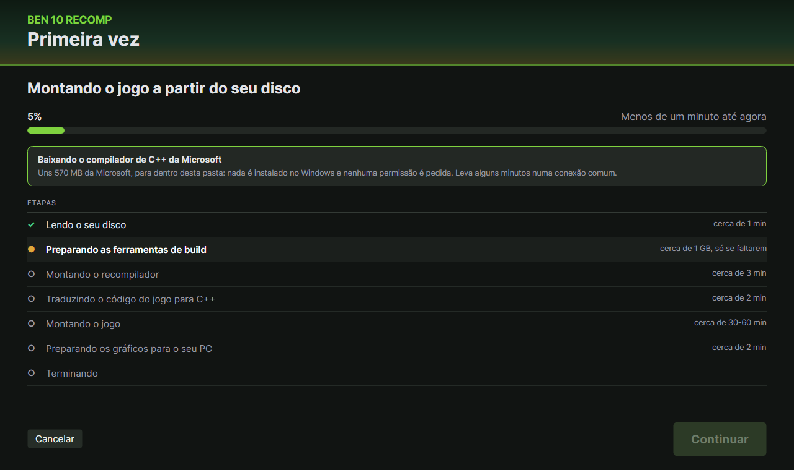
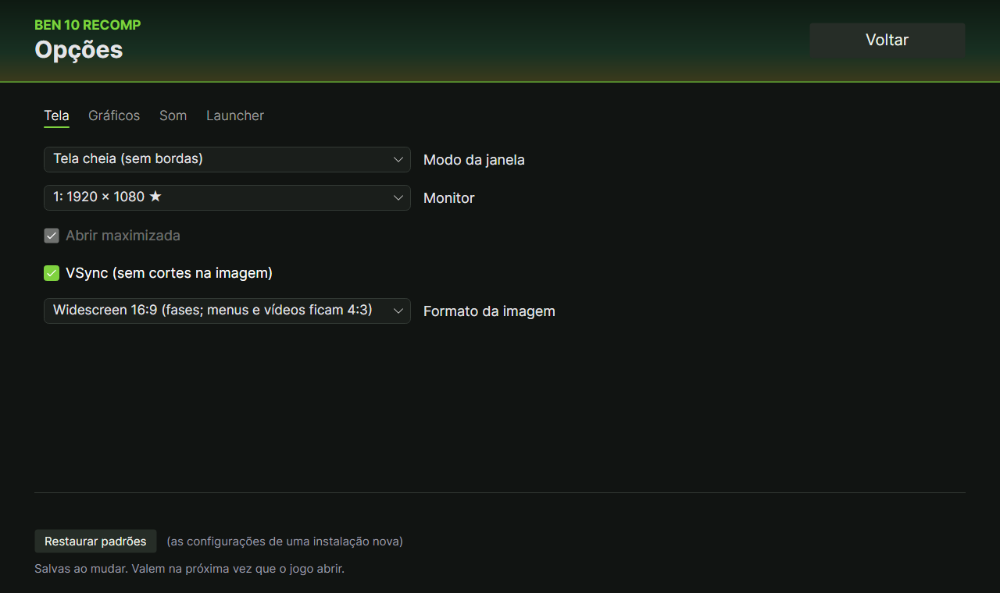
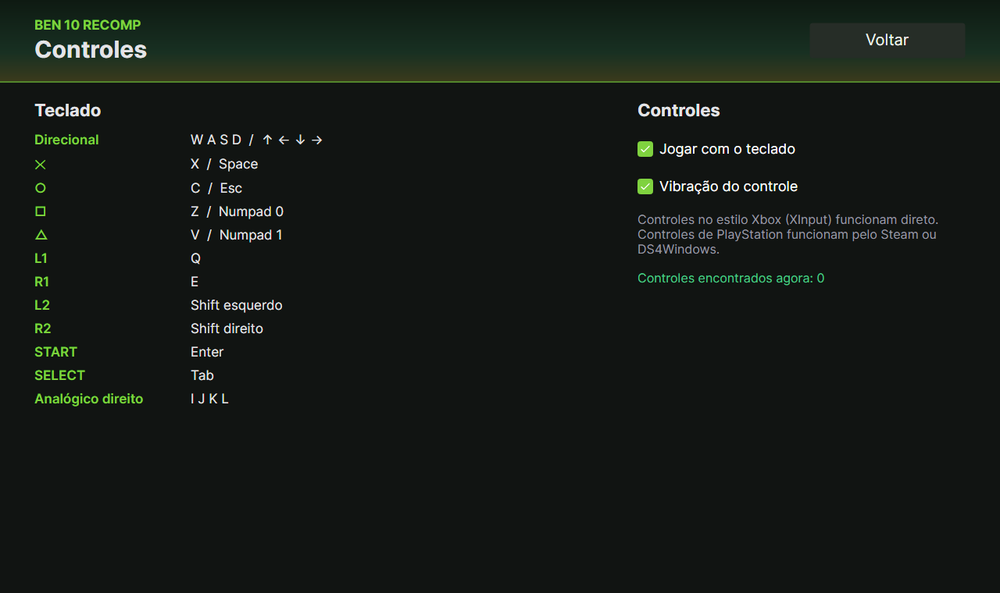
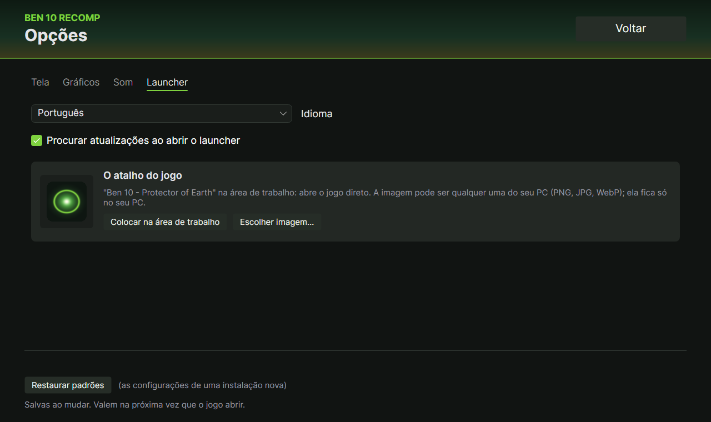
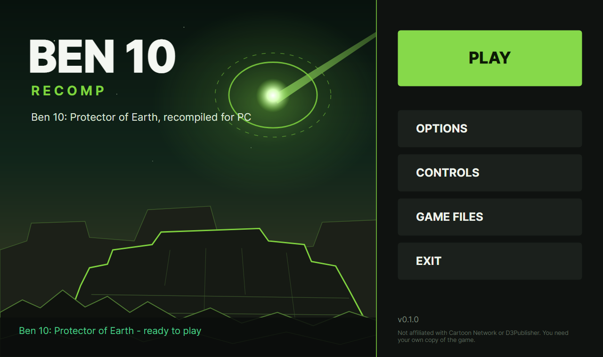

<p align="center"></p>

<h1 align="center">Ben 10: Protector of Earth — port nativo para PC</h1>

<p align="center">
  <a href="https://github.com/guilhermeperecim-jpg/ben10-protector-of-earth-pc/releases/latest/download/Ben10-Recomp-Windows.zip"></a>
</p>

<p align="center"><a href="https://recomplauncher.com"><picture><source media="(prefers-color-scheme: dark)" srcset="https://recomplauncher.com/assets/press/launcher/badge-light.svg"></picture></a></p>

<p align="center">
  
  
  
  
</p>

<p align="center">
  <a href="#english"><b>English below</b></a> ·
  <a href="https://github.com/guilhermeperecim-jpg/ben10-protector-of-earth-pc/releases/latest">Download</a> ·
  <a href="#como-jogar">Como jogar</a> ·
  <a href="#status">Status</a> ·
  <a href="#problemas-conhecidos">Problemas conhecidos</a> ·
  <a href="https://github.com/guilhermeperecim-jpg/ben10-protector-of-earth-pc/issues">Reportar um problema</a>
</p>

> [!NOTE]
> **Jogável, em desenvolvimento.** O jogo abre, toca os vídeos, passa pelos menus e chega às fases com som, saves e
> 60 quadros por segundo. As primeiras fases foram testadas a fundo; o jogo inteiro, do começo ao fim, ainda não.
> Veja o [Status](#status).

**Ben 10: Protector of Earth** (PlayStation 2, SLUS-21661 v1.01, EUA) rodando no PC como um programa nativo, sem
emulador: o código do jogo é traduzido para C++ e compilado para o seu processador, o PS2 é reimplementado em volta
dele, e o chip gráfico roda na sua placa de vídeo pelo Vulkan. Feito com o [PS2Recomp](https://github.com/ran-j/PS2Recomp)
e o runtime do [def-jam-vendetta-recomp](https://github.com/jcsix694/def-jam-vendetta-recomp).

> [!IMPORTANT]
> **Nenhum arquivo do jogo vem neste projeto.** Para jogar, você precisa da sua própria cópia: uma ISO feita do seu
> disco. O launcher monta o jogo no seu PC a partir dela, e nada do jogo sai do seu computador.

Por [guilhermeperecim-jpg](https://github.com/guilhermeperecim-jpg)

| | |
|---|---|
|  |  |
|  |  |
|  |  |

<sub>Telas do launcher, desenhadas pelo próprio programa. A arte é original do projeto; nenhuma imagem do jogo é
publicada aqui.</sub>

## Novidades (0.1.0)

- **Primeira versão pública:** launcher em português e inglês, com JOGAR, OPÇÕES, CONTROLES e ARQUIVOS DO JOGO.
- **Acha a sua ISO sozinho:** na primeira abertura, procura nas pastas do usuário e nos discos e confere se é a versão
  certa. Se não achar, é só apontar o arquivo.
- **Sem instalar o Visual Studio:** o launcher baixa da Microsoft só as partes do compilador de C++ que o build usa
  (uns 570 MB), para dentro da pasta do jogo, sem pedir administrador. O instalador oficial fica só como plano B.
- **Atalho na área de trabalho** com o nome do jogo e a imagem que você escolher (Opções › Launcher).
- **Pasta conferida ao abrir:** se o launcher estiver numa pasta que não serve para montar o jogo (dentro do zip, no
  OneDrive, com acentos, funda demais ou protegida pelo Windows), ele explica o motivo e se muda sozinho para
  `C:\Jogos\Ben 10 Recomp`.
- **Atualizações:** o launcher avisa quando sai versão nova e atualiza mantendo saves e configurações.

## Status

| Área | Estado |
|---|---|
| Boot, logos, vídeos de abertura, título e menus | ✅ Funciona |
| Jogo nas fases | ✅ Testado no Grand Canyon: andar, lutar, combos, inimigos, tutorial do Omnitrix e mapa-múndi |
| Jogo inteiro, do começo ao fim | 🧪 Ainda não testado |
| Saves | ✅ Memory card: o save é criado e o "Continue Game" carrega |
| Som | ✅ Música e efeitos, com o eco do chip de som do PS2 |
| Vídeos (Bink) | ✅ Com som; testados os de abertura e a introdução (os outros passam pelo mesmo caminho) |
| Imagem | ✅ Na placa de vídeo (Vulkan), de 1x a 16x a resolução do PS2, com FSR |
| Desempenho | ✅ 60 quadros por segundo na fase (GeForce GTX 1650, nitidez 8x) |
| Widescreen 16:9 | ✅ Nas fases e no pause · 🔧 o HUD fica esticado |
| Teclado | ✅ Funciona |
| Controle | 🧪 Xbox (XInput) com vibração; PlayStation pelo Steam ou DS4Windows. Pouco testado com controle de verdade |
| Launcher | ✅ Português e inglês |
| Instalação a partir do disco | ✅ Testada do zero em PCs diferentes, inclusive em pastas com espaço no nome |
| Windows 10 / 11 | ✅ Funciona |
| Linux | 📋 Planejado |

## Planos

| Plano | Estado |
|---|---|
| Linux | 📋 Planejado |
| HUD em 16:9 sem esticar | 📋 Planejado |
| 60 FPS na lógica do jogo | 🔧 Em estudo: o patch de 60 FPS do PCSX2 quebra o pulo |
| Testar o jogo inteiro | 🔧 Em andamento |

Detalhes de cada fase em [`docs/CHECKLIST.md`](docs/CHECKLIST.md).

## Download

O [**último lançamento**](https://github.com/guilhermeperecim-jpg/ben10-protector-of-earth-pc/releases/latest) traz:

- **Windows 10 / 11, 64 bits:** `Ben10-Recomp-Windows.zip` (86 MB)

O zip tem o launcher, um Python portátil e o código-fonte (o recompilador, o runtime e as bibliotecas). **Não tem nada
do jogo:** o jogo é montado no seu PC, a partir do seu disco. Depois de montado, ocupa uns 15 GB.

## Arquivos do jogo necessários

Só um: a **ISO do seu disco** de Ben 10: Protector of Earth, versão americana 1.01. Não precisa da BIOS do PS2.

| | |
|---|---|
| Serial | SLUS-21661 (NTSC-U), versão 1.01; o Original e o Greatest Hits são o mesmo disco |
| Tamanho | 3.400.499.200 bytes |
| CRC32 | `872c6408` |
| SHA-1 | `d212e3cbe2cf234b98c4d0cb35e0edc555b83d6e` |
| Referência | [redump 20349](http://redump.org/disc/20349/) |

O launcher confere o executável dentro da ISO e recusa outra versão ou um arquivo errado.

**PC:** Windows 10 ou 11 de 64 bits, placa de vídeo com Vulkan e driver atualizado (testado numa GeForce GTX 1650),
uns 15 GB livres e internet na primeira montagem.

## Como jogar

1. **Baixe e descompacte** o zip num caminho curto, como a Área de Trabalho ou `C:\Jogos`.
2. **Abra o `Ben 10 Recomp Launcher.exe`.** Na primeira vez ele procura a sua ISO sozinho (Downloads, Área de
   Trabalho, Documentos e os discos) e confere se é a versão certa. Se não achar, clique em **Procurar…** ou arraste o
   arquivo para a janela.
3. **Monte o jogo.** O launcher baixa o compilador de C++ da Microsoft para dentro da pasta do jogo e monta o jogo a
   partir do seu disco. **Leva de 30 a 60 minutos, uma vez só.** Dá para usar o PC enquanto isso.
4. **JOGAR.** Depois disso o jogo abre na hora, pelo launcher ou pelo atalho **Ben 10 - Protector of Earth**.

> [!TIP]
> Se aparecer **"O Windows protegeu o computador"**, clique em **Mais informações** e depois em **Executar assim
> mesmo**. O programa ainda não é assinado com um certificado pago.

## O launcher

| Tela | Para que serve |
|---|---|
| **Início** | JOGAR, o estado do jogo, a placa de vídeo, o processador e a memória, a versão e o aviso de atualização |
| **Primeira vez** | acha e confere a sua ISO e monta o jogo, mostrando cada etapa |
| **Opções › Tela** | modo da janela, monitor, começar maximizado, VSync e formato da imagem (16:9, 4:3 ou esticado) |
| **Opções › Gráficos** | placa de vídeo ou processador, nitidez (1x a 16x), ajuste à janela (FSR, suave ou pixels) e HUD nítido |
| **Opções › Som** | volume e eco |
| **Opções › Launcher** | idioma, atualizações e o atalho do jogo |
| **Controles** | o mapa do teclado, ligar ou desligar o teclado e a vibração |
| **Arquivos do jogo** | o disco conferido, as pastas do jogo, dos saves e dos logs, montar de novo ou escolher outro disco |

## Controles

| PS2 | Teclado | Controle Xbox |
|---|---|---|
| Direcional | W A S D / setas | direcional |
| Analógico esquerdo | — | analógico esquerdo |
| Analógico direito | I J K L | analógico direito |
| ✕ ○ □ △ | X, C, Z, V (ou Espaço, Esc, Numpad 0, Numpad 1) | A, B, X, Y |
| L1 / R1 | Q / E | LB / RB |
| L2 / R2 | Shift esquerdo / Shift direito | LT / RT |
| START / SELECT | Enter / Tab | Start / Back |

## Configurações e saves

- **Saves:** em `files\game\mc0` (Arquivos do jogo › Abrir os saves). Copie essa pasta para ter um backup.
- **Configurações:** no launcher (Opções) ou em `files\settings.toml`. Valem na próxima vez que o jogo abrir.
- **Atualizar** mantém os saves e as configurações.

## Problemas conhecidos

| Situação | O que acontece | O que fazer |
|---|---|---|
| **"O Windows protegeu o computador"** | o SmartScreen segura programas sem assinatura paga | Mais informações › Executar assim mesmo |
| **Pasta que não serve** (OneDrive, acentos, funda demais, protegida) | o build falha nessas pastas | o launcher avisa ao abrir e se muda sozinho |
| **Jogo lento** | nitidez alta demais para a placa de vídeo | baixe a nitidez em Opções › Gráficos (16x pede uma placa forte) |
| **Depois de atualizar o driver de vídeo** | a primeira abertura prepara os gráficos de novo | espere alguns minutos, só acontece uma vez |
| **HUD esticado em 16:9** | o HUD acompanha a tela larga, como no patch de widescreen do PCSX2 | normal por enquanto; 4:3 em Opções › Tela |
| **Foto cinza no mapa-múndi** | é o "cartão-postal" do local, vazio até você juntar os cards | normal |
| **O download do compilador falha** | o launcher abre o instalador oficial da Microsoft como plano B | aceite a instalação, ou tente de novo mais tarde |

Achou outro problema? Abra uma [issue](https://github.com/guilhermeperecim-jpg/ben10-protector-of-earth-pc/issues)
com o log (Arquivos do jogo › Abrir os logs).

## Compilar do código-fonte

O build traduz o código do jogo a partir do seu disco, então você também precisa de uma ISO. Este repositório não tem
arquivos nem código do jogo: tudo o que é feito a partir do disco (`disc/`, `game/`, `generated/`) fica no seu PC e
fora do git.

1. Visual Studio 2022 (C++), CMake, Ninja, Python 3, Git e .NET 10 SDK (launcher). Para refazer a análise: Ghidra 12.2
   com `ghidra-emotionengine-reloaded`.
2. Recrie `third_party/` com os patches: [`patches/README.md`](patches/README.md).
3. `python -I tools\prepare_disc.py "<sua ISO>"` (confere a ISO e extrai os arquivos do disco para `game/`).
4. Siga os comandos de [`docs/CHECKLIST.md`](docs/CHECKLIST.md) (Fase 1), ou faça como o jogador:
   `python -I tools\setup_game.py --data <pasta> --disc "<sua ISO>"`.
5. Jogue: `powershell -ExecutionPolicy Bypass -File tools\play.ps1 -Iso "<sua ISO>"`.
6. Launcher: `dotnet build -c Release launcher`. Pacote do jogador: `python -I tools\make_release.py` (em `dist\`).

Ative uma vez a verificação que impede publicar arquivos do jogo (roda antes de cada commit):

```
git config core.hooksPath tools/githooks
python -I tools/check_publish.py --all
```

## Como funciona

| Camada | O que faz | Base |
|---|---|---|
| Recompilador | traduz o código MIPS do `SLUS_216.61` para C++, no PC do jogador | [PS2Recomp](https://github.com/ran-j/PS2Recomp) |
| Runtime | reimplementa o PS2: kernel, IOP e módulos, memory card, CD (lido da ISO) e o chip de som | [def-jam-vendetta-recomp](https://github.com/jcsix694/def-jam-vendetta-recomp) |
| Gráficos | o chip gráfico do PS2 na placa de vídeo, em Vulkan, com resolução alta e FSR | [paraLLEl-GS](https://github.com/Arntzen-Software/parallel-gs) |
| VU1 | os microprogramas do VU1 compilados em C++ em vez de interpretados (de ~10 para 60 FPS) | `tools/vu1_recomp.py` |
| Específico do Ben 10 | vídeos Bink pelo FFmpeg, widescreen, leitura do disco e correções | `overrides/` |
| Launcher e instalação | conferir o disco, baixar o compilador, montar o jogo, opções e atualizações | `launcher/`, `tools/setup_game.py` |

## Créditos e aviso legal

- [PS2Recomp](https://github.com/ran-j/PS2Recomp) (ran-j e colaboradores): o recompilador e o runtime base
- [def-jam-vendetta-recomp](https://github.com/jcsix694/def-jam-vendetta-recomp) (jcsix694): o runtime sobre o
  PS2Recomp, a instalação a partir do disco e o programa de configurações em que o launcher se baseia
- [paraLLEl-GS](https://github.com/Arntzen-Software/parallel-gs) (Arntzen Software): o chip gráfico do PS2 na placa de vídeo
- O visual do launcher se inspira no do PL:A Recomp

GPL-3.0 ([`LICENSE`](LICENSE)); cada parte de terceiros e a sua licença: [`THIRD-PARTY-NOTICES.txt`](THIRD-PARTY-NOTICES.txt).


Este projeto não tem vínculo com a Cartoon Network, a D3Publisher ou a High Voltage Software. Ben 10 é marca da Cartoon
Network. Nenhum código, arquivo ou arte do jogo é distribuído aqui. O ícone e as telas do launcher são arte original do
projeto.

---

<a id="english"></a>

# Ben 10: Protector of Earth — native PC port

> [!NOTE]
> **Playable, in development.** The game boots, plays its movies, goes through the menus and reaches the levels with
> sound, saves and 60 frames per second. The first levels were tested in depth; the whole game, start to finish, not
> yet.

**Ben 10: Protector of Earth** (PlayStation 2, SLUS-21661 v1.01, USA) running on PC as a native program, without an
emulator: the game's code is translated to C++ and compiled for your processor, the PS2 is reimplemented around it, and
the graphics chip runs on your graphics card through Vulkan.

> [!IMPORTANT]
> **No game files come with this project.** To play, you need your own copy: an ISO made from your own disc. The
> launcher builds the game on your PC from it, and nothing of the game leaves your computer.

<p align="center"></p>

## What's new (0.1.0)

- **First public release:** a launcher in English and Portuguese, with PLAY, OPTIONS, CONTROLS and GAME FILES.
- **Finds your ISO by itself** on the first launch, and checks that it is the right version.
- **No Visual Studio install:** the launcher downloads only the parts of Microsoft's C++ compiler the build uses (about
  570 MB) into the game's folder, no administrator. The official installer is only a fallback.
- **Desktop shortcut** with the game's name and a picture of your choice (Options › Launcher).
- **Folder checked on open:** in a folder the build can't use (inside the zip, OneDrive, accents, too deep, protected),
  the launcher says why and moves itself to `C:\Jogos\Ben 10 Recomp`.
- **Updates:** the launcher tells you about a new version and updates, keeping saves and settings.

## Project status

| Area | State |
|---|---|
| Boot, logos, opening movies, title and menus | ✅ Works |
| Levels | ✅ Tested in Grand Canyon: walking, fighting, combos, enemies, the Omnitrix tutorial and the world map |
| The whole game, start to finish | 🧪 Not tested yet |
| Saves | ✅ Memory card: the save is created and "Continue Game" loads it |
| Sound | ✅ Music and effects, with the PS2 sound chip's echo |
| Movies (Bink) | ✅ With sound |
| Image | ✅ On the graphics card (Vulkan), 1x to 16x the PS2's resolution, with FSR |
| Performance | ✅ 60 frames per second in the levels (GeForce GTX 1650, 8x) |
| Widescreen 16:9 | ✅ Levels and pause · 🔧 the HUD is stretched |
| Keyboard | ✅ Works |
| Controller | 🧪 Xbox (XInput) with rumble; PlayStation through Steam or DS4Windows. Not tested much with a real controller |
| Windows 10 / 11 | ✅ Works |
| Linux | 📋 Planned |

## How to play

1. **Download and unzip** [`Ben10-Recomp-Windows.zip`](https://github.com/guilhermeperecim-jpg/ben10-protector-of-earth-pc/releases/latest/download/Ben10-Recomp-Windows.zip)
   somewhere short, like the desktop or `C:\Games`.
2. **Open `Ben 10 Recomp Launcher.exe`.** It looks for your ISO and checks it. If it can't find it, click **Browse…** or
   drop the file on the window.
3. **Build the game:** 30 to 60 minutes, once, with internet. You can use the PC meanwhile.
4. **PLAY.** From then on the game opens right away, from the launcher or the desktop shortcut.

**You need:** 64-bit Windows 10 or 11, a graphics card with Vulkan and an up-to-date driver, about 15 GB free, and the
ISO of Ben 10: Protector of Earth, USA v1.01 (SLUS-21661, 3,400,499,200 bytes, CRC32 `872c6408`,
[redump 20349](http://redump.org/disc/20349/)). No PS2 BIOS needed.

If **"Windows protected your PC"** appears, click **More info**, then **Run anyway**: the program is not signed with a
paid certificate yet.

Controls, settings, known problems and building from source are in the Portuguese sections above; the tables read the
same. Problems: open an [issue](https://github.com/guilhermeperecim-jpg/ben10-protector-of-earth-pc/issues) with the
log (Game files › Open the logs).

## Credits and legal notice

Built on [PS2Recomp](https://github.com/ran-j/PS2Recomp) (ran-j and contributors),
[def-jam-vendetta-recomp](https://github.com/jcsix694/def-jam-vendetta-recomp) (jcsix694) and
[paraLLEl-GS](https://github.com/Arntzen-Software/parallel-gs) (Arntzen Software); the launcher's look is inspired by
PL:A Recomp's. GPL-3.0 ([`LICENSE`](LICENSE), [`THIRD-PARTY-NOTICES.txt`](THIRD-PARTY-NOTICES.txt)).

This project is not affiliated with Cartoon Network, D3Publisher or High Voltage Software. Ben 10 is a trademark of
Cartoon Network. No game code, files or art are distributed here. The icon and the launcher screens are original
artwork made for this project.
